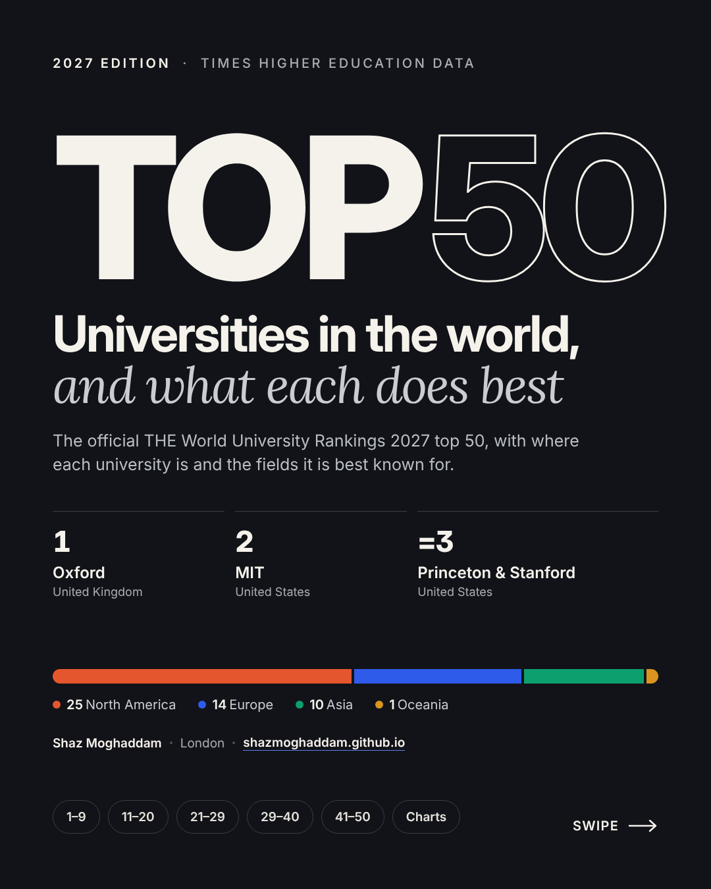
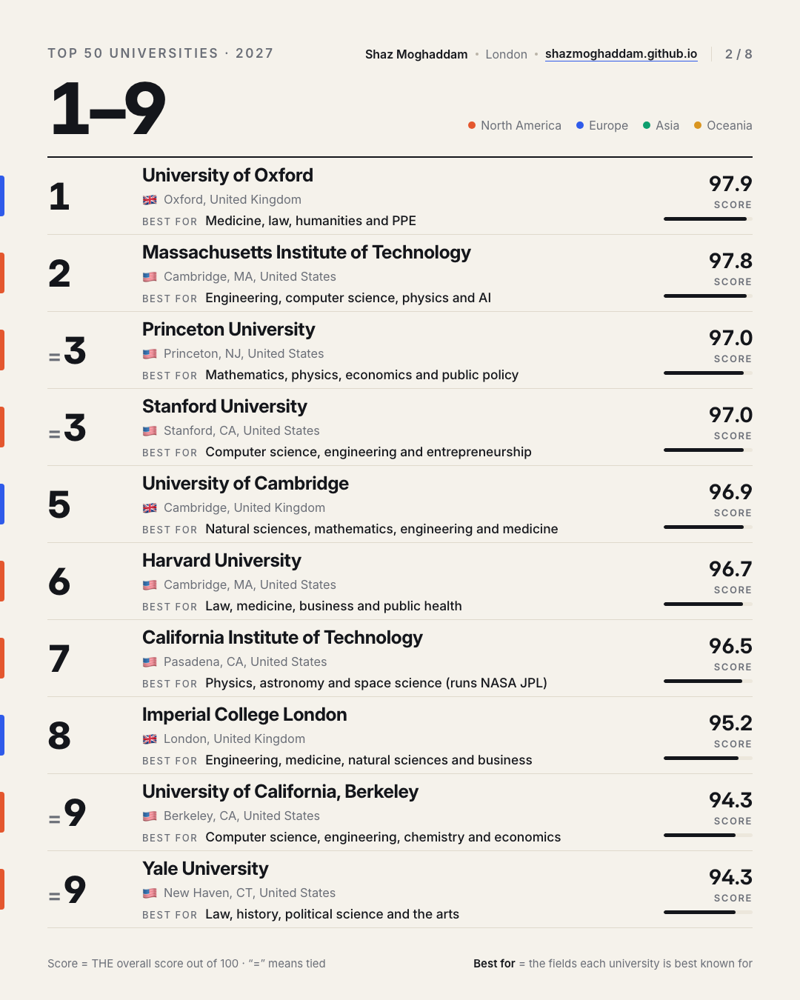
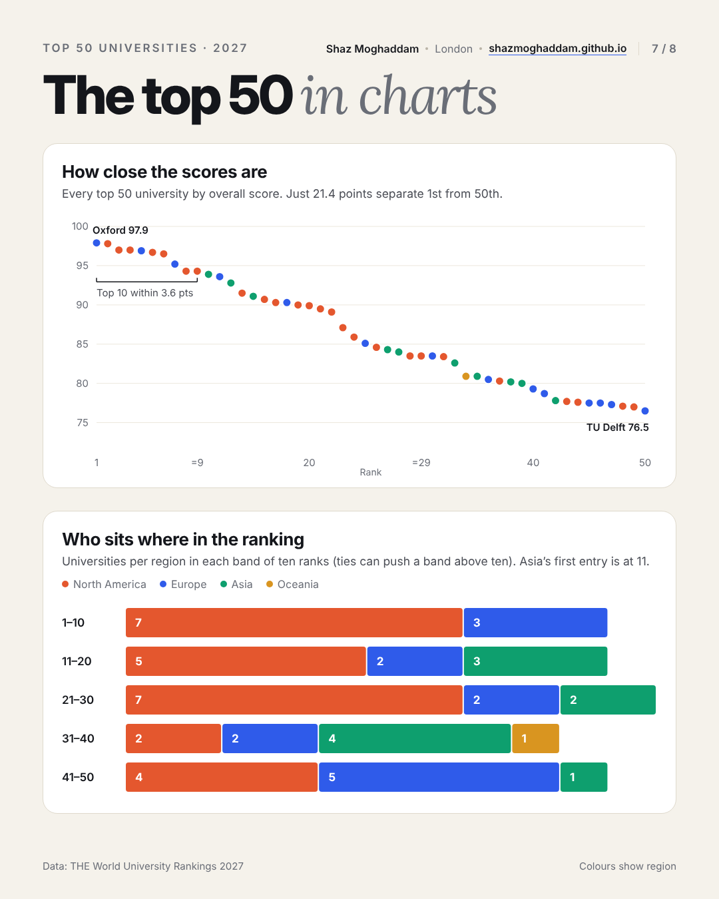

# Top 50 Universities 2027

An 8-page carousel of the world's top 50 universities from the **Times Higher Education (THE) World University Rankings 2027**, showing each university's rank, location, overall score and what it is best known for. A single Python script builds it from a CSV, as a PDF for LinkedIn and as 1080×1350 images for Instagram.

<p>
  
  
  
</p>

**[Download the PDF](output/Top-50-Universities-2027.pdf)** · all slides are in [`output/slides`](output/slides)

## What's inside

| Page | Content |
|---|---|
| 1 | Cover: top 3, regional split, links to each page |
| 2 to 6 | The top 50, ten per page: rank, location, score and "Best for" |
| 7 | Charts: how close the scores are, and the regional mix in each rank band |
| 8 | Key takeaways, top 50 by country, and the source |

## How the data was checked

- Every rank, tie and overall score comes from the official THE World University Rankings 2027 table, published on 30 September 2026.
- The full list was cross-checked against THE's own regional tables (for example Europe and Germany) and against the results reported at launch for UK and Asian universities.
- After each build, the PDF's text is compared with the CSV so that every name, score and "Best for" line matches.
- Page headings show the real rank range on each page. Because of ties, the first page covers ranks 1 to 9 (Berkeley and Yale are joint 9th) and Edinburgh (joint 29th) is the 31st entry.

**"Best for" is my own short summary** of each university's best known fields. It is not an official THE subject ranking.

## Build it yourself (macOS)

```bash
python3 -m venv .venv
source .venv/bin/activate
pip install -r requirements.txt
python -m playwright install chromium
python build.py
```

This writes `output/Top-50-Universities-2027.pdf` and `output/slides/slide-1.png` to `slide-8.png`.

Then run `python check.py` to confirm the data is in order and the PDF matches it. GitHub runs the same check on every push and pull request. Fonts (Inter and Lora) load from Google Fonts. Without a connection, locally installed fonts are used.

## Updating for a new edition

1. Copy `data/the-2027-top50.csv` to a new file such as `data/the-2028-top50.csv` and enter the new table.
2. Copy `data/edition-2027.json` to `data/edition-2028.json`, then update the edition year, data file name, takeaway cards and source line.
3. Run `python build.py data/edition-2028.json`.

The charts, country counts, page headings and cover are all calculated from the CSV, so only the takeaway text needs writing by hand.

## Project structure

```
data/
  the-2027-top50.csv     ranks, locations, scores and "Best for" for all 50
  edition-2027.json      edition settings, takeaway cards, source and byline
  README.md              where the data comes from
build.py                 builds the HTML, PDF and slides
check.py                 checks the CSV and that the PDF matches it
output/                  the generated PDF and slides
```

## Built with

Python · Playwright (headless Chromium, HTML/CSS to PDF) · hand-built SVG charts · Inter and Lora fonts. Region colours were checked for colour-blind separation, and every chart segment also carries a number label.

## Credits and licence

Ranking data © Times Higher Education, from the [THE World University Rankings 2027](https://www.timeshighereducation.com/world-university-rankings/latest/world-ranking). This project is not affiliated with or endorsed by THE. The data is reproduced with credit for information and commentary, and isn't covered by this repo's licence.

The code is released under the [MIT licence](LICENSE).

Made by **Shaz Moghaddam** in London · [shazmoghaddam.github.io](https://shazmoghaddam.github.io)
